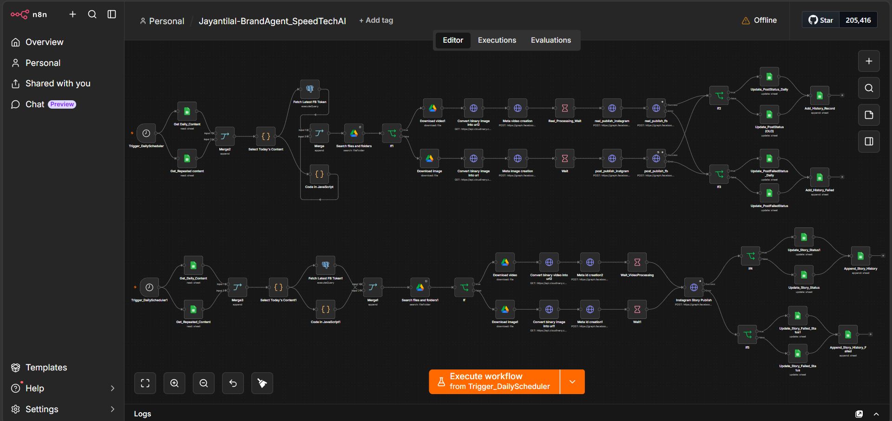
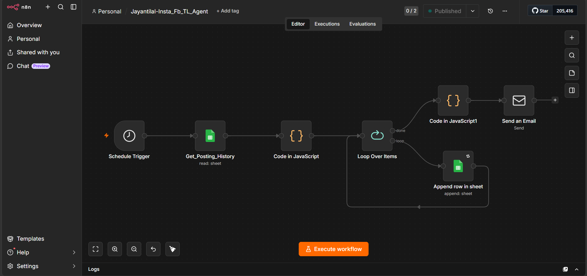
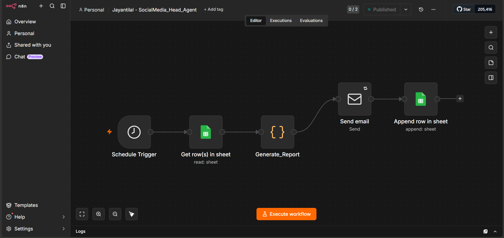

# Social Media Automation Agent

An n8n-based social media automation system developed during my internship to automate content publishing, media processing, status tracking, posting history, monitoring, and reporting.

## Overview

The system uses multiple n8n workflows to manage different parts of the social media automation process.

### Workflow Components

- **Social Media Agent** – Handles scheduled content processing, media retrieval, image/video processing, social media publishing, and post/story status tracking.
- **TL Monitoring Agent** – Processes posting history and generates team-level monitoring reports.
- **Head Monitoring Agent** – Generates overall monitoring reports and automated email reports.

## Key Features

- Scheduled social media content processing
- Google Sheets-based content management
- Content selection and rotation
- Google Drive media retrieval
- Image and video processing
- Instagram and Facebook publishing
- Post and story status tracking
- Posting history management
- Success and failure tracking
- Workflow monitoring
- Automated report generation
- HTML email reporting

## Technology Stack

- n8n
- Google Sheets
- Google Drive
- Meta Graph API
- REST APIs
- Webhooks
- JavaScript
- HTML Email Reports

## Workflow Architecture

Content Management  
↓  
Content Selection  
↓  
Media Retrieval & Processing  
↓  
Social Media Publishing  
↓  
Status Tracking  
↓  
Posting History  
↓  
Monitoring & Reporting

## Workflow Screenshots

### 1. Social Media Agent

Main workflow responsible for scheduled content processing, media handling, social media publishing, and status tracking.

### 2. TL Monitoring Agent

Workflow responsible for processing posting history and generating team-level monitoring and reporting outputs.

### 3. Head Monitoring Agent

Workflow responsible for generating overall monitoring reports and sending automated email reports.

## My Contribution

- Designed and maintained n8n automation workflows for social media operations.
- Implemented content processing, publishing, status tracking, and reporting workflows.
- Integrated Google Sheets, Google Drive, and Meta APIs.
- Worked on post and story publishing automation.
- Implemented posting history and monitoring workflows.
- Built automated HTML email reporting workflows.
- Debugged workflow execution issues and worked on production workflow recovery.

## Project Context

This project was developed as part of my internship work and involved building and maintaining automation workflows for social media operations.

Production credentials, private configuration, company data, and confidential workflow files are not included in this repository.
